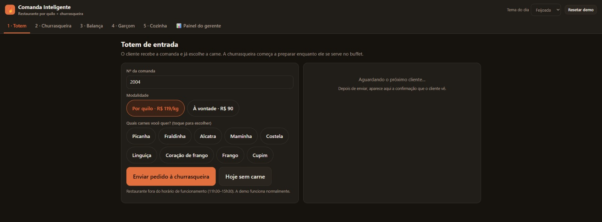
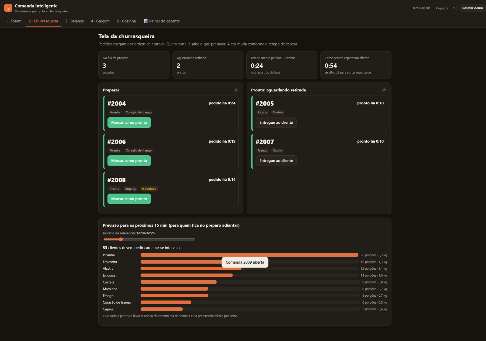
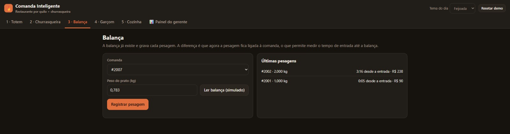
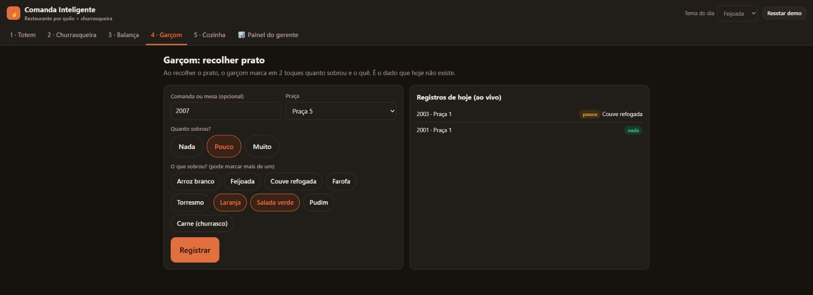
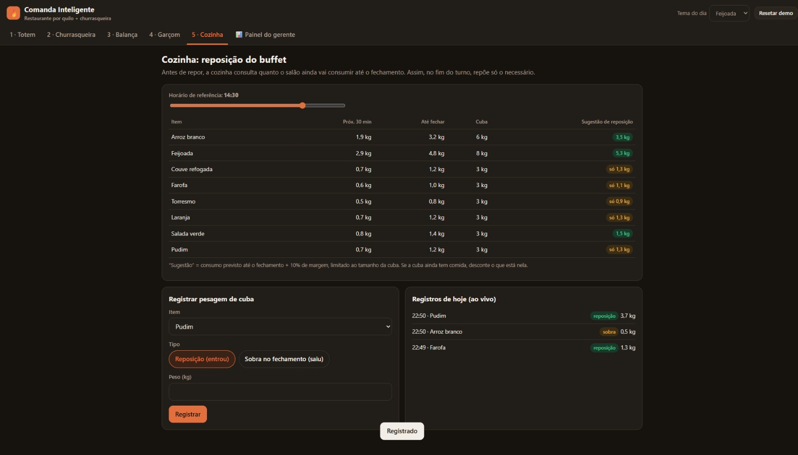
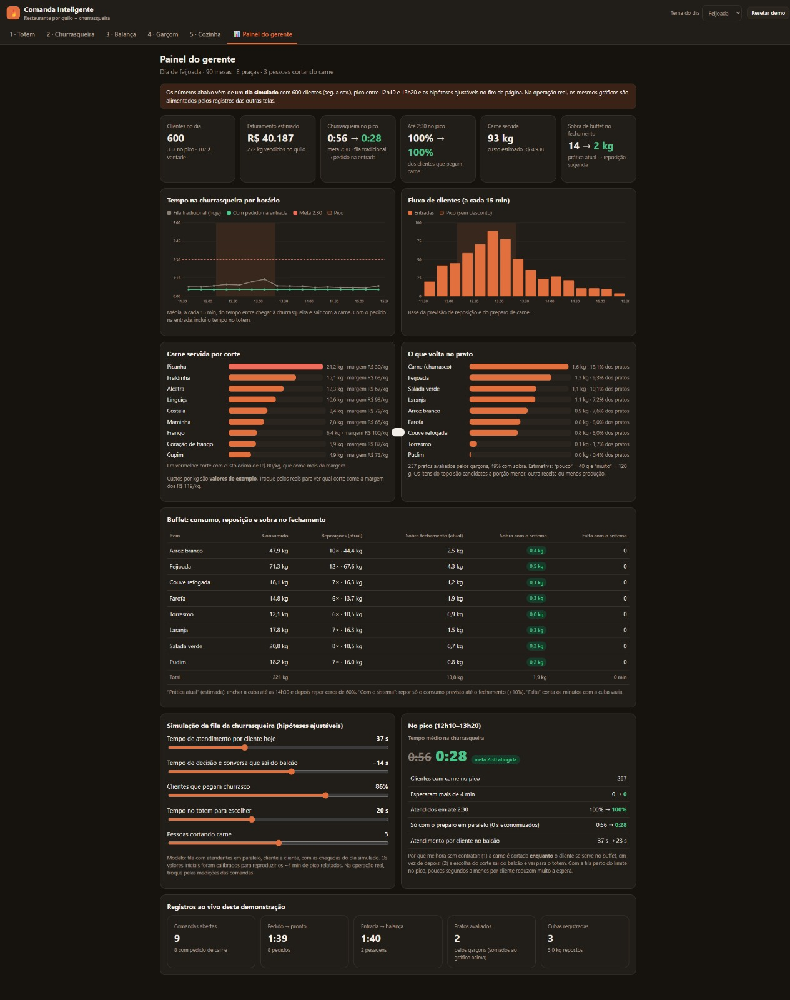

# 🔥 Comanda Inteligente

Solução proposta no hackathon da FMU para um restaurante por quilo com churrasqueira. O objetivo é **reduzir a fila no horário de pico**, **saber o que sai e o que sobra** e **repor o buffet na medida certa**, sem contratar mais funcionários.

## Integrantes
Daniel Barbosa Alves

## O problema

- Restaurante por quilo (R$ 119/kg ou R$ 90 à vontade), 90 mesas, 8 garçons e cerca de 600 clientes por dia de segunda a sexta.
- O público é executivo e tem pressa. Com muitos concorrentes por perto, **quem vê fila vai embora**.
- No pico (12h10–13h20), a fila da churrasqueira leva **cerca de 4 minutos**. A meta é **2min30**.
- O buffet é reposto "no olho": no fim do turno, ou sobra comida ou falta.
- A balança grava cada pesagem, mas não sabe de quem é nem o que tem no prato. Não existe controle de sobras.

## A ideia central: fazer as etapas em paralelo

Hoje as etapas acontecem uma depois da outra:

```
Entrada → Buffet → Fila da churrasqueira (~4 min) → Balança
```

Com a Comanda Inteligente, o cliente **escolhe a carne ao receber a comanda**. A churrasqueira corta enquanto ele se serve no buffet:

```
Entrada + pedido da carne → Buffet (a carne está sendo cortada) → Retirada rápida → Balança
```

Isso reduz o **tempo real** de espera, não só a sensação de espera. A escolha do corte e a conversa também saem do balcão, o que encurta cada atendimento.

## O sistema

A comanda vira o identificador do cliente durante toda a visita, e cada etapa registra um horário.

| Tela | O que faz |
|---|---|
| **1 · Totem** | Abre a comanda (por quilo ou à vontade) e recebe o pedido de carne. |
| **2 · Churrasqueira** | Mostra os pedidos por ordem de chegada, com cronômetro que muda de cor depois de 2:30. Tem a previsão de porções por corte para os próximos 15 min. |
| **3 · Balança** | Liga a pesagem à comanda e mede o tempo da entrada até a balança. Aplica o desconto de 10% fora do pico. |
| **4 · Garçom** | Ao recolher o prato, registra em 2 toques quanto sobrou e o quê. |
| **5 · Cozinha** | Mostra o consumo previsto até o fechamento e sugere quanto repor de cada item. Registra a pesagem das cubas. |
| **📊 Painel do gerente** | Indicadores, fluxo de clientes, espera na churrasqueira (antes × depois), carne por corte e margem, sobras no prato, buffet e simulação da fila com hipóteses ajustáveis. |

## Telas

### 1 · Totem de entrada
O cliente recebe a comanda, escolhe a modalidade e marca as carnes que quer.



### 2 · Churrasqueira
Pedidos por ordem de chegada com cronômetro, coluna de prontos aguardando retirada e previsão de porções para os próximos 15 minutos.



### 3 · Balança
A pesagem fica ligada à comanda e mostra o tempo da entrada até a balança e o valor.



### 4 · Garçom
Ao recolher o prato, o garçom registra quanto sobrou e o quê.



### 5 · Cozinha
A tabela mostra quanto ainda vai ser consumido até o fechamento e quanto repor. Embaixo, o registro das pesagens de cuba.



### 📊 Painel do gerente
Indicadores do dia, espera na churrasqueira (antes × depois), fluxo de clientes, carne por corte e margem, o que volta no prato, consumo e sobra do buffet, simulação da fila com hipóteses ajustáveis e registros ao vivo.



> Nesta captura, os controles da simulação estão alterados (37 s de atendimento, −14 s, 86%). Por isso a espera aparece como 0:56 → 0:28. Com os valores padrão, calibrados para os ~4 min relatados, o painel mostra os números da seção abaixo.

## Resultados da simulação

Dia simulado com 600 clientes, tema feijoada, calibrado para reproduzir os ~4 min de pico relatados:

| Indicador | Hoje | Com o sistema |
|---|---|---|
| Tempo na churrasqueira no pico, só com o preparo em paralelo | 4:00 | **1:48** |
| Idem, com o atendimento no balcão 6 s mais rápido | 4:00 | **0:37** |
| Clientes atendidos em até 2:30 no pico, só com o preparo em paralelo | 47% | **69%** |
| Idem, com o atendimento no balcão 6 s mais rápido | 47% | **100%** |
| Sobra de buffet no fechamento | ~14 kg | **~2 kg** |

> ⚠️ Esses números vêm de um **modelo com hipóteses ajustáveis** (tempo de atendimento, % de clientes que pegam carne, tempo no totem, número de pessoas cortando). Os 0:37 dependem do ganho de 6 s por atendimento, que é uma suposição, não uma medição. Os custos por kg das carnes são valores de exemplo. Na operação real, o próprio sistema mede os números a partir dos horários registrados nas comandas.

## Apresentação

O arquivo `apresentacao.html` tem os 5 slides do pitch, com as imagens já embutidas. Abra no navegador e navegue com as setas ← → ou clicando nas laterais. A tecla `F` liga a tela cheia. Para gerar um PDF, use Imprimir → Salvar como PDF: sai uma página por slide.

## Como rodar

Não precisa instalar nada nem ter internet. É um arquivo único:

1. Abra o `index.html` no navegador.
2. Para a demonstração, abra duas abas lado a lado:
   - `index.html#totem`
   - `index.html#churras`

   As abas se sincronizam: um pedido feito no totem aparece na hora na churrasqueira.
3. Outras telas: `#balanca`, `#garcom`, `#cozinha` e `#painel`.

Outros controles:

- **Tema do dia** (no topo): troca os itens do buffet (feijoada, árabe, italiana, brasileira).
- **Resetar demo**: apaga os registros ao vivo.

Os registros ficam salvos no navegador (`localStorage`). O dia simulado é gerado com uma semente fixa, então os números são sempre os mesmos.

### Roteiro sugerido para a demonstração

1. **Totem:** escolha picanha e linguiça e envie o pedido.
2. **Churrasqueira:** o pedido aparece com o cronômetro. Marque como pronto.
3. **Balança:** "Ler balança" e "Registrar". Mostra o tempo da entrada até a balança e o valor.
4. **Garçom:** registre "sobrou muito: farofa".
5. **Painel:** mostre os indicadores e mexa nos controles deslizantes da simulação.

## Como a simulação funciona

- **Chegadas:** 600 clientes distribuídos entre 11h30 e 15h30, com pico entre 12h10 e 13h20.
- **Fila atual:** o cliente sai do buffet e entra na fila. Três churrasqueiros atendem em paralelo, com tempo de atendimento variável.
- **Com o sistema:** o pedido entra na fila de corte no momento em que o cliente está no totem. O cliente passa de 2,5 a 5 min no buffet e só espera se a carne ainda não estiver pronta. O tempo no totem é somado à espera, para a comparação ser justa.
- **Buffet:** cada cuba é simulada minuto a minuto. Na prática atual, a cuba é cheia até as 14h30 e depois reposta em cerca de 60%. Com o sistema, a reposição é o consumo previsto até o fechamento mais 10%. O painel também mostra os minutos em que a cuba ficou vazia.

## Próximos passos

- Fazer um piloto de 2 semanas para medir o antes e o depois com dados reais.
- Integrar com a balança e o banco de dados atuais do restaurante.
- Identificar sobras por foto do prato com IA.
- Avisar "agora sem fila, 10% off" para atrair clientes fora do pico.
- Prever a demanda por tema do dia e dia da semana com o histórico acumulado.

## Estrutura

```
index.html     # aplicação completa (HTML + CSS + JavaScript, sem dependências)
apresentacao.html  # slides da apresentação (5 slides, abre no navegador)
README.md
docs/telas/    # capturas de tela usadas neste README
```
